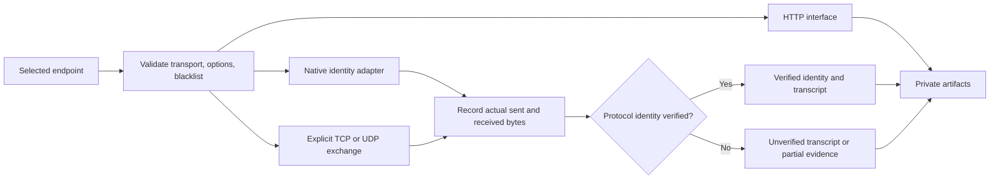

# Capture actions and evidence

Source of truth: `leakscope/phase3/capture.py`, `native.py`, `wire.py`, and the shared `HTTP_CAPTURE_TYPES` in `fingerprints.py`.

Capture availability follows the observed transport, HTTP scheme, and implemented protocol adapter. A conventional port is never required. A provider service label remains a candidate until an actual identity handshake succeeds.

| Action | Available for | Retained evidence |
| --- | --- | --- |
| `http` | Observed HTTP(S), or a defined HTTP service profile, on any TCP port | Response body, headers, transfer facts, and curl request/response hex trace |
| `httpx` | Same HTTP interfaces | Selected-endpoint fingerprint JSON, including response facts when supplied by the tool |
| `screenshot` | Same HTTP interfaces | Browser PNG and navigation metadata |
| `check` | TCP connection, with verified TLS for observed HTTPS/grpcs | Reachability JSON only; no application payload, invented wire bytes or protocol identity |
| `identity` | Implemented native adapter with its required transport | Parsed identity JSON, transcript JSON, and actual sent/received binary streams |
| `tcp` | Every TCP endpoint, including unknown technologies | One connection with optional explicit payload, bounded response, and lossless binary/hex evidence |
| `udp` | Every unicast UDP endpoint | One explicit nonempty datagram, one bounded reply, and lossless binary/hex evidence |

Binary protocols produce transcripts, not browser screenshots. A known HTTP profile selects an initial HTTP scheme; successful capture still requires a real HTTP response or browser navigation. HTTPS can be selected explicitly through the endpoint scheme. HTTP redirects and browser requests retain the existing endpoint restrictions.

Unclassified TCP endpoints on 80, 443, 8000, 8080, and 8443 also offer HTTP capture attempts for compatibility. This is a candidate interface, not verified HTTP identity; a known native label does not become HTTP solely because it uses one of these ports.



## Manual exchange options

The worker accepts `config['TCP_OPTIONS']` or `config['UDP_OPTIONS']`. The queue freezes these options with the capture run. Payloads are explicit manual input; a generic exchange does not choose a probe based on a port number.

```json
{
  "payload": "0048454c4c4fff",
  "encoding": "hex",
  "timeout_seconds": 3,
  "tls": false
}
```

- `encoding`: `text` (UTF-8) or `hex`; defaults to `text`.
- `payload`: at most 4,096 decoded bytes. Empty TCP payload means receive only. UDP requires a nonempty payload and rejects the `tls` option.
- `timeout_seconds`: 1–10 seconds, shared by DNS, connection/TLS, sending, and receiving. DNS waits are bounded, with at most four outstanding resolver threads. TCP selects one resolved address and makes one connection attempt.
- `tls`: TCP only, defaults to false. The worker verifies the hostname and certificate using its trust store. The transcript contains **decrypted TLS application bytes**, not encrypted records or a packet capture.

TCP receives until EOF, the shared deadline, or 65,536 bytes. Reaching the byte limit is explicitly partial. UDP sends one datagram and receives one datagram from the selected peer; it performs no multicast or broadcast discovery. A connected UDP socket does not prove that a service is reachable. Existing destination blacklist checks apply to every capture; private LAN addresses are allowed unless blacklisted.

If hostname blacklist validation needs DNS, that separate preflight has a three-second budget before the exchange's maximum ten-second budget. Literal-address blacklist checks do not resolve DNS. All resolved answers are still checked against the blacklist, and preflight resolution failure rejects the capture.

## Native identity operations

Adapters are limited to service identity/negotiation: Redis PING/INFO server; MySQL greeting; PostgreSQL SSLRequest; Memcached stats; MongoDB hello; FTP/SSH/rsync greetings; Modbus Read Device Identification; OPC UA HEL/ACK; EtherNet/IP ListIdentity; IEC 104 TESTFR; BACnet unicast Who-Is/I-Am; NFS RPC NULL; SMB2 NEGOTIATE; S7 COTP/SetupCommunication; MQTT clean CONNECT/CONNACK followed by DISCONNECT when accepted; RTSP OPTIONS; gRPC fixed Health/Check over HTTP/2.

MQTT does not publish, subscribe, supply credentials, or retain a session. RTSP does not describe, set up, or play streams. The MQTT packet framing follows [OASIS MQTT 3.1.1](https://docs.oasis-open.org/mqtt/mqtt/v3.1.1/os/mqtt-v3.1.1-os.html); RTSP OPTIONS framing follows [RFC 2326](https://www.rfc-editor.org/rfc/rfc2326.html). `identify()` preserves its `(metadata, verified_type)` return value; its optional recorder observes actual I/O without changing adapter results.

## Artifact and failure contract

`wire-transcript` JSON contains `sent` and `received` objects with full bounded `hex`, UTF-8 `text`, and an explicit text-decoding note. Hex and raw artifacts are lossless; invalid UTF-8 uses replacement characters in text. Event records store direction, stream offset, byte count, and elapsed milliseconds. At most 256 event records are retained; all bounded stream bytes remain available even if further event records are omitted.

Raw `wire-request` and `wire-response` artifacts exist when that direction has bytes. They contain application stream bytes in order, not TCP packet boundaries. Native BACnet uses the same evidence format for actual UDP datagrams. The `wire_summary` contains byte/event counts, transport, TLS flag, connection status, termination, and receive-limit status.

Successful native identity includes `metadata.identity_verified: true` and `verified_type`. Generic exchanges always set `identity_verified: false` and never return `verified_type`. Protocol rejection or a timeout after actual application I/O raises `CaptureEvidenceError(ValueError)` with `.result` containing the retained artifacts, top-level `partial: true`, and metadata `partial: true`, `identity_verified: false`, `error`, and `wire_summary`. The queue persists that evidence as partial without classifying the endpoint as verified. Refused connections and silent failed attempts with no application bytes fail without fabricated transcripts.

Curl failures use the same partial-result contract when its trace contains actual application header/data sends or receives. Retention includes the bounded trace and any body/headers within their individual and combined limits. Connection-refusal informational messages alone do not qualify as exchange evidence.

Artifacts retain the private atomic storage boundary: mode 0600, generated filenames, SHA-256, byte counts, and a combined publication limit of 16 MiB. Curl preserves its actual request/response `http-trace`; HTTP bodies remain limited to 2 MiB and headers to 64 KiB. Capture subprocesses retain fixed argument vectors, scrubbed environment variables, output bounds, process-group cleanup, and existing deadlines. Transcripts can contain target-supplied content or manually entered payloads and remain private capture evidence.

## gRPC identity

The `grpc` profile offers identity and generic TCP capture; it does not offer a browser screenshot merely because its scheme is HTTP(S). The adapter sends only `grpc.health.v1.Health/Check` with an empty service name. Cleartext uses prior-knowledge HTTP/2; HTTPS/grpcs uses certificate and hostname verification plus required h2 ALPN. No fallback disables verification.

The shared deadline defaults to 3 seconds and is capped at 10. Bounds are 64KiB aggregate application exchange, 8KiB decoded headers and one 4KiB health protobuf. A complete native gRPC response with valid status can establish the protocol even when Health is unimplemented or authentication is required. It never proves Milvus or another application identity. Metadata and actual HTTP/2 binary request/response are retained separately; TLS artifacts contain decrypted application bytes. No reflection or arbitrary application RPCs are performed.

## Response candidates versus capture eligibility

A provider query can find an exporter or management WebUI without finding a native database listener. The Milvus profile alone therefore no longer enables curl/httpx/screenshots; observed HTTP(S) still does. Aerospike exporter, SAP HANA XS and legacy Beckhoff BC queries likewise do not declare their native protocols to be HTTP.

## Discover collection policies

`collection_policy.plan_collection` separates Passive (no target requests), Semi-passive (HTTP/native fingerprint or TCP check), Screenshot (eligible web only) and Full (all applicable captures). Automatic HTTP eligibility follows observed HTTP(S) or a known HTTP profile, never an unknown endpoint’s conventional port. Native identity already retains wire evidence, so Full does not duplicate that exchange. Generic UDP still requires an explicit manual payload; no automatic bytes are invented. Parent lookup results record queued/skipped/limited/failed counts and child run IDs. Child results/artifacts record actual completion.

The check action shares a bounded DNS/connect/TLS budget (default3, maximum10 seconds) and persists actual positive connection evidence with identity/protocol verification false. Existing blacklist preflight remains separate. Check timing and collection policy are ignored by stable response hashing while remaining visible in artifacts/run context.

## Playwright browser controller

Web screenshots now use Playwright with system Chromium; gowitness remains an explicit Strict endpoint alternative. Native VNC uses its separate protocol capture. A clean `Dockerfile.capture` build includes the controller and Xvfb; `deploy/Dockerfile.assets-capture` updates an existing capture-toolchain image.

Before the first Compose start, create the internal controller credential as the deployment user:

```sh
python3 deploy/init_browser_secret.py --data-root .runtime/docker3
```

Use your actual `LEAKSCOPE_DATA_ROOT` (the default is `.runtime/docker`). An explicit `LEAKSCOPE_BROWSER_TOKEN_SOURCE` may point elsewhere. The helper retains an existing valid credential and never prints it. Ensure the file is readable by the configured application UID/GID; back it up with the Django secret and provider configuration. Compose mounts it read-only and publishes no controller port. Web and capture containers use `BROWSER_CONTROL_URL=http://fetch:9227` and `BROWSER_CONTROL_TOKEN_FILE=/run/secrets/browser_control_token` internally.

Strict endpoint capture only loads the selected host and port. Web page capture permits public HTTP(S) page dependencies on ports80/443 plus the selected endpoint, and same-site canonical main-page redirects. Other private destinations stay blocked. Both profiles have network, request, time, image-size and height limits; blocked/failed resources and render diagnostics are saved with each image. A successful PNG does not prove page completeness.

The endpoint detail offers a Verification browser: one temporary, target-bound headed browser session with live frames and explicit click/text/key/scroll controls. Sessions expire after ten minutes and discard their browser state on close. Capture saves the current page through the normal evidence job. No CDP, profile/cookie import/export, automated login or automatic verification bypass is exposed. Websites can still refuse the browser or require unsupported challenges.
