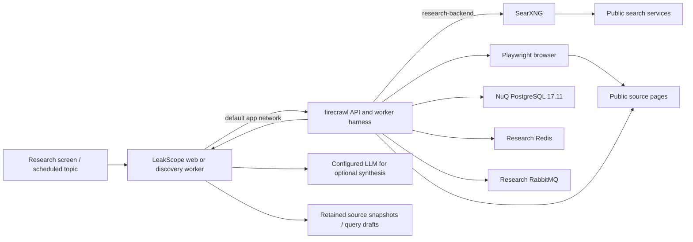

# Self-hosted Firecrawl research

LeakScope's default Compose deployment includes Firecrawl and SearXNG for web research. The application calls `http://firecrawl:3002/v2/search`; no Firecrawl Cloud key is needed for this internal instance. Ask and query synthesis continue to use LeakScope's separately configured OpenAI-compatible endpoint. Firecrawl itself needs no model provider for ordinary search and Markdown scraping.

## Architecture



Six additional services are installed by default: `firecrawl`, `firecrawl-browser`, `firecrawl-postgres`, `firecrawl-redis`, `firecrawl-rabbitmq` and `searxng`. Firecrawl's API and its worker processes run together under the upstream harness. `NUQ_WORKER_COUNT=1` limits its NuQ worker count; the browser allows two concurrent pages.

There are no new host port mappings. Only the Firecrawl API joins LeakScope's `default` network. All six services share `research-backend`, an internal Docker network; API, browser and SearXNG also join `research-egress` for outbound web requests. The three data services have no outbound network attachment. The browser keeps local-address scraping disabled (`ALLOW_LOCAL_WEBHOOKS=false`); isolated fixture testing may explicitly override this in its own project.

LeakScope retains its own PostgreSQL 18.6 application database and Redis broker. Firecrawl has independent PostgreSQL 17.11 queue storage, Redis and RabbitMQ. Do not point Firecrawl's queue at the application database or reuse its data directories.

## Pinned images

All listed manifests support Linux ARM64. Versions are recorded from the selected source or image metadata, not inferred from floating tag names.

| Service | Version / role | Immutable image reference |
| --- | --- | --- |
| API | Firecrawl 2.11.162 | `ghcr.io/firecrawl/firecrawl:2.11.162@sha256:1b223ef18d410f67615f32ccaa3dcedfc26af4286f096247bddca3b624545e63` |
| Browser | Playwright service, digest-pinned build | `ghcr.io/firecrawl/playwright-service@sha256:eacaf2c256a6ff7fd1869e470d2969e97a037ff6c75ac01d38784d138a33f8eb` |
| Queue DB | PostgreSQL 17.11 with upstream NuQ schema and pg_cron | `ghcr.io/firecrawl/nuq-postgres@sha256:d719b36160eac2fcbe16dc7e7360ddb9c82c40ea5da183d07bf4a755c6a0b2ae` |
| Redis | Redis 8.10.3, independent research data | `redis:8-alpine@sha256:71885d8cc6e42f2bc0aa2eb853bfc4be200b5108a46ac50e117ae1df0531fb80` |
| RabbitMQ | RabbitMQ 4.2.9 | `rabbitmq:4.2-alpine@sha256:dea0f5843025e0c3c1a128b14fc2e181ea59ff369e7048e6a7fbac83bd8c4f9d` |
| Search | SearXNG 2026.11.6-ac11e14c5 | `docker.io/searxng/searxng@sha256:c750ee1d859b26d3aeae51c07f6a48c3a0bfbaa9195d71a18b258862d88c4c3c` |

The Firecrawl tag resolves to source commit `7666c1f9ae8720a6bba271e0f60b6a217f8a5210`. Browser and NuQ images have no matching 2.11.162 registry tag, so their selected digests are retained explicitly. An independent comparison of the NuQ image's initialization SQL against the pinned API source found only an additional failed-listing index and its cron maintenance job; no incompatible table, column or function differences.

The upstream API uses AMQP exclusive auto-delete classic reply queues and durable quorum prefetch queues. These queue declarations are compatible with RabbitMQ 4.2; the actual scrape/search run remains the integration gate.

## Private configuration and storage

The private mode600 deployment `.env` must supply:

```dotenv
# Generate URL-safe random values; these placeholders are not deployable secrets.
LEAKSCOPE_FIRECRAWL_PASSWORD=<generated backend password>
LEAKSCOPE_SEARXNG_SECRET=<generated site secret>
# Optional private settings file; omit to use the tracked keyless template.
LEAKSCOPE_SEARXNG_CONFIG=/absolute/ignored/path/searxng-settings.yml
```

Use separate values generated with `secrets.token_urlsafe(48)`. The backend password initializes the independent Firecrawl PostgreSQL and RabbitMQ credentials. Its URL-safe form is required because Compose also inserts it into the AMQP connection URL. Existing initialized databases do not rotate their passwords merely because `.env` changes.

Create these bind directories under the selected `LEAKSCOPE_DATA_ROOT` before startup:

```text
firecrawl/postgres
firecrawl/redis
firecrawl/rabbitmq
firecrawl/searxng
```

All use `create_host_path: false`. PostgreSQL17 mounts `/var/lib/postgresql/data`, which differs from the main PostgreSQL18 mount layout. NuQ PostgreSQL and SearXNG run as `LEAKSCOPE_UID:LEAKSCOPE_GID` (default 501:20), matching the owner of the data directories. Keep `POSTGRES_DB=postgres`: upstream's pg_cron configuration targets that database. PostgreSQL readiness additionally requires both `nuq.queue_scrape` and `nuq.queue_crawl_finished`; accepting TCP connections alone does not establish successful initialization.

The browser/API have no persistent page-data bind mount. Research evidence that LeakScope chooses to retain lives in its application database; queue/broker state uses the separate bind directories above.

Compose supplies `FIRECRAWL_API_URL=http://firecrawl:3002/v2` to application services by default. A private file setting or saved DB integration profile can override it. To select the built-in service explicitly, save that base URL in **Configure integrations** and leave its API key empty. LeakScope distinguishes endpoint readiness (`configured`) from credential presence (`key_configured`). External Firecrawl-compatible endpoints remain supported; the Cloud hostname still requires a key.

## Free search and an optional Brave API key

The tracked [`searxng.yml`](searxng.yml) enables JSON results and the free DuckDuckGo, Brave website and Yahoo engines. These scrape public result pages and can encounter challenges, rate limits or upstream format changes. A running search container is not proof that those engines return useful results. Firecrawl's selected source also falls back to its DuckDuckGo search path when SearXNG returns no web results.

For an owner-provided **official Brave Search API** key, the renderer [`configure_search.py`](configure_search.py) creates private SearXNG settings. Pass the key through a private file, never a command-line key argument:

```sh
python3 deploy/firecrawl/configure_search.py \
  --key-file /private/ignored/path/brave-api-key \
  --output /absolute/ignored/path/searxng-settings.yml
```

The output is JSON, which is valid YAML for SearXNG. It is written atomically with mode600 and contains the key only in the `braveapi` engine definition. The renderer sets both `disabled: false` and `inactive: false`; the latter overrides SearXNG's inactive-by-default Brave API engine. No key contents are printed. Set `LEAKSCOPE_SEARXNG_CONFIG` to that absolute output path and recreate only `searxng` to load it.

This private configuration selects `braveapi` alone. The tracked free-engine template remains available by changing the selected settings path and recreating SearXNG. Brave's API has the account's actual quota/rate limits; a free subscription does not imply unlimited requests. Research and scheduled topics consume search requests, so choose schedule frequency accordingly. Keys stay outside Git, images and human workbench publications. They are mounted read-only into SearXNG; LeakScope's browser and LLM do not receive the Brave key.

## Resource and health boundaries

| Service | CPU / memory cap | Healthcheck |
| --- | --- | --- |
| API/harness |2 CPUs /3 GiB; Node heap 384 MiB per process | Local API root returns `message: Firecrawl API` |
| Browser |1.5 CPUs /1536 MiB; at most 2 pages | `/health` opens and closes a test browser page |
| NuQ PostgreSQL |0.5 CPU /768 MiB;128 MiB shared buffers | Actual queue tables exist |
| Research Redis |0.5 CPU /256 MiB;192 MiB data ceiling, no eviction | `PING` |
| RabbitMQ |0.5 CPU /512 MiB | `rabbitmq-diagnostics check_running` |
| SearXNG |1 CPU /512 MiB;128 MiB temporary directory | `/healthz` |

All six rotate Docker logs at10 MiB ×3 files. Redis persists with AOF. SearXNG runs with a read-only root filesystem, dropped capabilities and `no-new-privileges`; its private settings mount is read-only. The browser also drops capabilities and uses `no-new-privileges`. The API runs as UID 1000. No application login gate or host research ports are introduced.

Source/client boundaries remain bounded: LeakScope requests five research sources, stores at most five excerpts of 6000 characters and accepts a maximum1 MiB Firecrawl response. Optional LLM synthesis must cite values present in those retained sources. Search engine results and scraped text remain untrusted evidence; generated queries are drafts and never automatically execute themselves.

## Start, inspect and restart

From the canonical deployment directory, after private settings and storage exist:

```sh
docker compose config --quiet
docker compose up -d --wait firecrawl
# Starting Firecrawl also starts its declared research dependencies.
docker compose ps --format '{{.Service}} {{.State}} {{.Health}}'
docker compose logs --tail=80 firecrawl firecrawl-browser
```

Do not print resolved Compose configuration, environment, private search settings or full container inspection: they contain backend passwords or the owner's search key. A service root/health response is useful but does not replace a successful `/v2/search` result with source content and the end-to-end LeakScope Research test.

Restarting the harness/browser does not require restarting LeakScope web, its application database, Certstream or unrelated Docker workloads:

```sh
docker compose restart firecrawl firecrawl-browser
# After changing only the SearXNG settings source:
docker compose up -d --no-deps --force-recreate searxng
```

## Backup, recovery and rollback

Keep a compatible recovery set: exact image digests, selected source revision, private `.env`, any private Brave input/settings file, and the independent research storage. Back up NuQ PostgreSQL using a custom-format `pg_dump` rather than copying its running data directory. Its `pg_cron` extensions and NuQ schema belong to its PostgreSQL17 image; the application's PostgreSQL18 dump is separate. For a coordinated broker/filesystem backup, stop new research dispatch and drain active work before stopping the relevant writers and snapshotting Redis/RabbitMQ storage. Preserve RabbitMQ's stable hostname/node name with its state.

Restore and test in a separate project/network with matching images. Keep original application data and its matching `django-secret`; Firecrawl configuration does not replace that existing encrypted-profile recovery requirement. Verify searches, Markdown scraping and retained source links after restoration; stale pending research work is not proof of completed evidence collection.

Before new writes, rollback may select the matching earlier app/capture images and previous Firecrawl integration profile, then stop only the new research services. Keep their bind data and private settings available. After writes, account for any newly stored query suggestions/evidence before selecting a prior database recovery point. Never use `down -v`, global pruning or Docker Desktop restart as an upgrade procedure.

## Release checks still required

The release owner must record: all six service health states; no research host ports; keyless self-hosted settings/Research behavior; a real search through SearXNG and a scrape through Firecrawl; exact returned source and Markdown evidence; broker/queue initialization; restart persistence; private-key scan; LAN/Tailscale app health; and updated human/agent documentation. External engine failure and a 200 response with empty results must be reported honestly. No verification result is implied merely by this source integration document.

Primary references: [pinned Compose](https://github.com/firecrawl/firecrawl/blob/v2.11.162/docker-compose.yaml), [authentication bypass](https://github.com/firecrawl/firecrawl/blob/v2.11.162/apps/api/src/lib/withAuth.ts), [SearXNG search transport](https://github.com/firecrawl/firecrawl/blob/v2.11.162/apps/api/src/search/v2/searxng.ts), [NuQ PostgreSQL image source](https://github.com/firecrawl/firecrawl/blob/v2.11.162/apps/nuq-postgres/Dockerfile), [SearXNG Brave API engine](https://github.com/searxng/searxng/blob/ac11e14c5edf995d4d2f066bfb885a614f52a978/searx/engines/braveapi.py).

## Select an external Firecrawl instance

In Settings or Research → Configure integrations, set the Firecrawl API base URL including its API version, e.g. `https://firecrawl.example.internal/v2`. An external service’s key is optional when its authentication is disabled; otherwise enter that service’s Firecrawl key. The Brave Search API key belongs in SearXNG and is not a Firecrawl credential. Omitted key fields preserve existing values; Clear saved key is explicit.

This instance uses the owner-selected external base above. To select the bundled service, set `http://firecrawl:3002/v2`. The saved profile overrides the deployment default, and LeakScope does not silently replace a failed selected endpoint. Bundled services remain installed/running when an external URL is selected.

## Observed verification

Source `a061a20` deployed with 268 Python tests (5 opt-in skips), 60 JavaScript tests and 17 runtime tests passing. Local fixture scraping produced Markdown; Brave API returned 10 results; bundled search/Markdown and restart checks passed. External Firecrawl research returned five sources through LeakScope. Desktop/mobile research/settings checks passed. All six added services are healthy and publish no host ports. The configured LLM server returned HTTP502 during verification, so sources were returned with a synthesis warning; this was also reproduced on the prior unchanged app.
