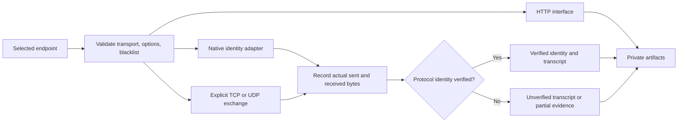

# Capture actions and evidence

Source of truth: `leakscope/phase3/capture.py`, `native.py`, `wire.py`, and the shared `HTTP_CAPTURE_TYPES` in `fingerprints.py`.

Capture availability follows the observed transport, HTTP scheme, and implemented protocol adapter. A conventional port is never required. A provider service label remains a candidate until an actual identity handshake succeeds.

| Action | Available for | Retained evidence |
| --- | --- | --- |
| `http` | Observed HTTP(S), or a defined HTTP service profile, on any TCP port | Response body, headers, transfer facts, and curl request/response hex trace |
| `httpx` | Same HTTP interfaces | Selected-endpoint fingerprint JSON, including response facts when supplied by the tool |
| `screenshot` | Same HTTP interfaces | Browser PNG and navigation metadata |
| `identity` | Implemented native adapter with its required transport | Parsed identity JSON, transcript JSON, and actual sent/received binary streams |
| `tcp` | Every TCP endpoint, including unknown technologies | One connection with optional explicit payload, bounded response, and lossless binary/hex evidence |
| `udp` | Every unicast UDP endpoint | One explicit nonempty datagram, one bounded reply, and lossless binary/hex evidence |

Binary protocols produce transcripts, not browser screenshots. A known HTTP profile selects an initial HTTP scheme; successful capture still requires a real HTTP response or browser navigation. HTTPS can be selected explicitly through the endpoint scheme. HTTP redirects and browser requests retain the existing endpoint restrictions.

Unclassified TCP endpoints on 80, 443, 8000, 8080, and 8443 also offer HTTP capture attempts for compatibility. This is a candidate interface, not verified HTTP identity; a known native label does not become HTTP solely because it uses one of these ports.



## Manual exchange options

The worker accepts `config['TCP_OPTIONS']` or `config['UDP_OPTIONS']`. The queue freezes these options with the capture run. Payloads are explicit manual input; a generic exchange does not choose a probe based on a port number.

```json
{
  "payload": "0048454c4c4fff",
  "encoding": "hex",
  "timeout_seconds": 3,
  "tls": false
}
```

- `encoding`: `text` (UTF-8) or `hex`; defaults to `text`.
- `payload`: at most 4,096 decoded bytes. Empty TCP payload means receive only. UDP requires a nonempty payload and rejects the `tls` option.
- `timeout_seconds`: 1–10 seconds, shared by DNS, connection/TLS, sending, and receiving. DNS waits are bounded, with at most four outstanding resolver threads. TCP selects one resolved address and makes one connection attempt.
- `tls`: TCP only, defaults to false. The worker verifies the hostname and certificate using its trust store. The transcript contains **decrypted TLS application bytes**, not encrypted records or a packet capture.

TCP receives until EOF, the shared deadline, or 65,536 bytes. Reaching the byte limit is explicitly partial. UDP sends one datagram and receives one datagram from the selected peer; it performs no multicast or broadcast discovery. A connected UDP socket does not prove that a service is reachable. Existing destination blacklist checks apply to every capture; private LAN addresses are allowed unless blacklisted.

If hostname blacklist validation needs DNS, that separate preflight has a three-second budget before the exchange's maximum ten-second budget. Literal-address blacklist checks do not resolve DNS. All resolved answers are still checked against the blacklist, and preflight resolution failure rejects the capture.

## Native identity operations

Adapters are limited to service identity/negotiation: Redis PING/INFO server; MySQL greeting; PostgreSQL SSLRequest; Memcached stats; MongoDB hello; FTP/SSH/rsync greetings; Modbus Read Device Identification; OPC UA HEL/ACK; EtherNet/IP ListIdentity; IEC 104 TESTFR; BACnet unicast Who-Is/I-Am; NFS RPC NULL; SMB2 NEGOTIATE; S7 COTP/SetupCommunication; MQTT clean CONNECT/CONNACK followed by DISCONNECT when accepted; RTSP OPTIONS.

MQTT does not publish, subscribe, supply credentials, or retain a session. RTSP does not describe, set up, or play streams. The MQTT packet framing follows [OASIS MQTT 3.1.1](https://docs.oasis-open.org/mqtt/mqtt/v3.1.1/os/mqtt-v3.1.1-os.html); RTSP OPTIONS framing follows [RFC 2326](https://www.rfc-editor.org/rfc/rfc2326.html). `identify()` preserves its `(metadata, verified_type)` return value; its optional recorder observes actual I/O without changing adapter results.

## Artifact and failure contract

`wire-transcript` JSON contains `sent` and `received` objects with full bounded `hex`, UTF-8 `text`, and an explicit text-decoding note. Hex and raw artifacts are lossless; invalid UTF-8 uses replacement characters in text. Event records store direction, stream offset, byte count, and elapsed milliseconds. At most 256 event records are retained; all bounded stream bytes remain available even if further event records are omitted.

Raw `wire-request` and `wire-response` artifacts exist when that direction has bytes. They contain application stream bytes in order, not TCP packet boundaries. Native BACnet uses the same evidence format for actual UDP datagrams. The `wire_summary` contains byte/event counts, transport, TLS flag, connection status, termination, and receive-limit status.

Successful native identity includes `metadata.identity_verified: true` and `verified_type`. Generic exchanges always set `identity_verified: false` and never return `verified_type`. Protocol rejection or a timeout after actual application I/O raises `CaptureEvidenceError(ValueError)` with `.result` containing the retained artifacts, top-level `partial: true`, and metadata `partial: true`, `identity_verified: false`, `error`, and `wire_summary`. The queue persists that evidence as partial without classifying the endpoint as verified. Refused connections and silent failed attempts with no application bytes fail without fabricated transcripts.

Curl failures use the same partial-result contract when its trace contains actual application header/data sends or receives. Retention includes the bounded trace and any body/headers within their individual and combined limits. Connection-refusal informational messages alone do not qualify as exchange evidence.

Artifacts retain the private atomic storage boundary: mode 0600, generated filenames, SHA-256, byte counts, and a combined publication limit of 16 MiB. Curl preserves its actual request/response `http-trace`; HTTP bodies remain limited to 2 MiB and headers to 64 KiB. Capture subprocesses retain fixed argument vectors, scrubbed environment variables, output bounds, process-group cleanup, and existing deadlines. Transcripts can contain target-supplied content or manually entered payloads and remain private capture evidence.

## Provider hints, rendered evidence and capture status

A provider's saved response text that opens with a protocol's own identification (for example `SSH-2.0-`) selects the matching native reader when the stored type is only a placeholder such as Shodan's `auto`. The hint is recorded on the capture as `metadata.protocol_hint` and is never a verification; an attempt that does not verify the protocol leaves the endpoint's stored type unchanged. A named protocol without a native reader is reported as unsupported.

Saved provider banners, `wire-transcript` artifacts and live observations that kept their exchange as hex are drawn once as `evidence-render` PNG artifacts. Each image states that it is rendered protocol evidence and not a screenshot, and carries the target, source and saved times, provenance, operation, outcome, response text, hex and decoded fields. Drawing reads saved records only. The raw wire files remain beside the image.

Images are classed as browser screenshot, native framebuffer capture or rendered protocol evidence. Every endpoint reports why a live capture is or is not present: succeeded, partial, failed, queued, not attempted, unsupported or not applicable.
