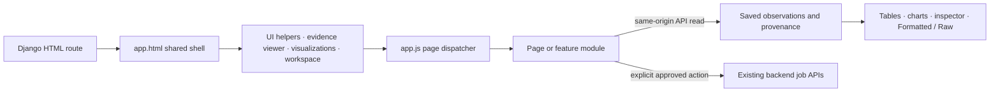

# LeakScope frontend system

This guide describes the real frontend sources inspected on 2026-11-09. It is a navigation aid, not an authority: verify the code before changing behavior. It does not certify a deployment or replace release verification.

## Entry point and data flow

[workbench_urls.py](../leakscope_app/workbench_urls.py) maps HTML routes to `workbench.shell`, which renders [app.html](../leakscope_app/templates/workbench/app.html). Its `body` attributes supply `page`, `type` and `target-id`. Each navigation loads a Django page; `app.js` chooses a renderer and populates `#page-root` with DOM nodes. There is no frontend framework or client-side route router to rebuild.



CSS order is `leakscope.css`, `relationships.css`, `expansion.css`, `ics.css`, `browser_sessions.css`, then `workspace.css`. Keep [workspace.css](../leakscope_app/static/css/workspace.css) last: it supplies the dark design tokens and overrides older feature styles. [leakscope.css](../leakscope_app/static/css/leakscope.css) still supplies the base component/layout rules.

All scripts are local, deferred classic scripts. Their exact order in the template is:

1. `utils.js` → `data_viewer.js` → `visualizations.js` → `workspace.js`.
2. `intelligence.js` → `presets.js` → `browser_sessions.js` → `operations.js`.
3. `cloud.js` → `relationships.js` → `expansion.js` → `ics.js` → `app.js`.

Load shared helpers before consumers and `app.js` last. These files live in [static/js/leakscope/](../leakscope_app/static/js/leakscope/); `app.js` exports job watching only after its helper declarations, then boots the selected page.

## Public browser APIs

| Namespace / source | Public entry points |
| --- | --- |
| `LeakScopeUI` / `utils.js` | `safeUrl`, `isTerminal`, `state`, `startedRuns`, `isSensitive`, `progress`, `text`, `date`, `number` |
| `LeakScopeShell` / `workspace.js` | `enhance(container)`, `openCommand()`, `closeCommand()`, `navKey(page)`, `motionEnabled()` |
| `LeakScopeListBar` / `list_toolbar.js` | `create({page, search, quick, more, describe, extraChips, onChange, views, insights, about, selection})` returns `{element, footer, pager, setCount, setSelected, refreshChips, dispose}`; makes no requests |
| `LeakScopeData` / `data_viewer.js` | `viewer(value, {label})` returns a DOM element; `label(key, path = "")` |
| `LeakScopeViz` / `visualizations.js` | `disclosure(options)`, `bars(options)`, `timeline(options)`, `endpointInsights(options)`, `organizationMap(options)` |
| `LeakScopeWorkbench` / `app.js` | `watchRun(run, container, onComplete, options = {})` |
| `LeakScopeOperations` / `operations.js` | `render(root, page)`, `openTags(kind, key, currentTags, onSaved)`, `openLookup(seed)` |
| `LeakScopeAssets` / `relationships.js` | `render(root, page)`, `openTools(referenceOrTarget)`, `monitor(domain)`, `addToOrganization(referenceOrTarget)` |
| `LeakScopeIntelligence` / `intelligence.js` | `openSimilar(references)`, `openAsk(references, options)`, `renderResearch(root)`, `openSettings(onSaved)` |
| Other feature namespaces | `LeakScopePresets.openCreate(references)/openManager()`; `LeakScopeBrowser.open(endpoint, options)/close()`; `LeakScopeCloud.render(root)`; `LeakScopeExpansion.render(root)/open(options)/url(options)/dispose()`; `LeakScopeICS.render(root)/openRelated(reference)/openInspection(reference)` |

Build untrusted values with DOM text, not HTML interpolation. Existing feature modules have local DOM helpers and fallbacks when shared components are absent; the production template loads the shared components. Preserve typed saved references such as `{type:"endpoint", id}` when handing a result to another feature.

## Route and source map

The 21 top-level workspaces below share the same shell and design. `app` means [app.js](../leakscope_app/static/js/leakscope/app.js); other names identify sibling JavaScript modules.

| Route | `data-page` | Renderer owner / primary data |
| --- | --- | --- |
| `/` | `overview` | app / `/api/summary` |
| `/discover/` | `discover` | app / local query preview, explicit discovery, saved run output |
| `/cloud/` | `cloud` | cloud / `/api/operations/cloud/*` |
| `/findings/` | `findings` | app / `/api/findings` |
| `/assets/` | `assets` | operations / `/api/operations/endpoints`; `?endpoint=` opens a saved endpoint |
| `/lookups/` | `lookups` | operations / saved lookups and catalog |
| `/monitoring/` | `monitoring` | operations / stream health and watches |
| `/certificates/` | `certificates` | relationships / local certificate records; `?id=` opens detail |
| `/organizations/` | `organizations` | relationships / saved organizations; `?id=` opens detail |
| `/domain-expansion/` | `domain-expansion` | expansion / saved expansion sessions and reviewed candidates |
| `/relationships/` | `relationships` | relationships / `/api/assets/graph`; optional `?root=` |
| `/ics/` | `ics` | ics / saved gallery, context and explicit protocol tools |
| `/runs/` | `runs` | app / `/api/runs` |
| `/custom-queries/` | `queries` | app / saved query CRUD and explicit run controls |
| `/research/` | `research` | intelligence / suggestions and explicit research |
| `/technologies/` | `catalog` | operations / technology catalog |
| `/analysis/` | `analysis` | operations / `/api/operations/analysis` |
| `/preview/` | `preview` | app `inspection("preview")` / explicit preview API |
| `/explore/` | `explore` | app `inspection("explore")` / explicit exploration API |
| `/export-import/` | `exports` | app / explicit export/import controls |
| `/settings/` | `settings` | app, with intelligence integration settings dialog |

`/findings/<type>/<id>/` is the additional `detail` state in app. Legacy aliases such as `/home/`, `/keyword/`, `/search/`, `/database/` and `/catalog/` reuse these renderers; check `workbench_urls.py` for the full alias list. Do not modernize an unused legacy HTML template and expect it to change this shell.

## Dark styling, motion and disclosure state

- `html[data-theme="dark"]` and `color-scheme:dark` make dark the default independently of system light preference. Final tokens include `--canvas:#080d15`, `--paper:#111a27`, `--ink:#e5edf8`, `--muted:#9eafc5`, `--rule:#28374a`, `--accent:#83e5d5`, and `--accent-strong:#b0f4e8`.
- Feature-compatible aliases include `--border`, `--surface`, `--bg-subtle`, `--background` and `--text-muted`. Use these tokens for new surfaces instead of adding light literals or separate palettes.
- `workspace.js` decorates added `.panel`, `.metric` and `.run-card` elements under `#page-root` with `.holo-surface`. Each card has a fixed surface tint and a gently shifting iridescent rim. This CSS finish is independent of pointer position; there is no cursor-following lighting or pointer tracking. CSS also supplies restrained entrances and status effects.
- Motion preference is `localStorage["leakscope.motion"]`. `.motion-paused` and `prefers-reduced-motion` freeze card iridescence and suppress animation/transitions; system reduced motion disables the toggle. This affects presentation, **not** running jobs, ingestion or health polling. Production does not generate simulated events.
- Navigation uses `leakscope.nav.compact` and `leakscope.nav.group.<group>`. Active groups open on page load; compact mode exposes navigation items and returns to group preferences when expanded. Mobile navigation is controlled by `#menu-toggle`.
- Shell disclosures use `details[data-disclosure-id]` and `leakscope.disclosure.<id>`. Visualization disclosures separately use `leakscope:visualization:<id>` with `open/closed` values. Keep IDs stable and distinct. Blocked local storage must not prevent rendering.
- Cmd/Ctrl K opens local navigation search; arrows choose links, Enter follows them, Escape closes it and restores focus. `[` toggles compact navigation outside editable controls/dialogs. These controls make no provider requests.

## Structured evidence and numeric precision

Use [data_viewer.js](../leakscope_app/static/js/leakscope/data_viewer.js) for structured display, including metadata and error objects, rather than a new raw `pre`. A viewer starts in Formatted; its independent Raw JSON toggle serializes the untouched input with `JSON.stringify(value, null, 2)`. Toggling preserves the component's expanded formatted content.

Readable labels, dates, fingerprints, boolean/null/empty states and unknown keys retain access to the original data. Nested objects/arrays render lazily; collections initially show 32 entries with explicit more controls. Strings over 4,000 characters expand on request. Raw content is serialized only when requested. Keys and values are literal text; provider HTML never executes.

JSON-encoded strings can be formatted structurally while Raw JSON retains the original string, including whitespace. Native reviver `context.source` preserves exact number lexemes: unsafe integers, high-precision decimals, exponents, underflow and negative zero are not rounded for display. Without that feature, conservative token scanning skips quoted strings and keeps risky numeric JSON as original literal text. Already-parsed provider objects can only display supplied numeric values; lost upstream precision cannot be reconstructed.

Issuer/subject paths and issuer/subject viewer labels expand X.509 `C`, `L`, `O`, `OU`, `ST`, `CN` and lowercase forms. Generic single-letter keys stay generic. Plain queries, wire bytes, textual responses and intentional JSON editors retain their dedicated text/editor views. Existing sensitive-value reveal controls still gate structured evidence.

## Visualization truth and limits

`LeakScopeViz` creates DOM only; callers supply records and callbacks. `bars` accepts `{label,key,count,href?,onSelect?}` rows; `timeline` accepts `{date,count}` rows. Counts must be finite and nonnegative. These components show 25 rows initially and cap supplied chart rows at 2,000 with a limit note; organization maps initially expose 12 associations. Native buttons/links, text counts and live readouts support keyboard use.

- Overview's source chart counts distinct saved endpoints **per provider**; one endpoint can appear under several sources. Job states summarize the latest eight saved runs, not full history.
- Endpoint insights describe the supplied page and matching total separately. Discover initially reads up to ten saved endpoints from one completed lookup job; Observations uses its existing paginated endpoint API. Technology selection reuses local filtering; age selection inspects saved records. Last-seen timestamps are not live availability checks.
- Analysis derives its data in [phase3/analysis.py](../leakscope/phase3/analysis.py). Provider bars count observations; technology/category bars count endpoints; tags can overlap. Its timeline uses observation **first collection dates in the last 30 days**, not provider scan times. Missing dates are not fabricated as zero.
- Monitoring's chart groups the latest 20 persisted watch-match records by their last collected UTC date. It is a bounded saved-record sample, not certificate throughput. Received/matched/dropped are persisted cumulative counters across ingestor restarts; [certstream.py](../leakscope/phase3/certstream.py) adds flushed deltas to database counters.
- Monitoring retains five-second polling while visible and stops its page timer on disposal. Chart refresh avoids replacing a focused chart. Motion controls do not change this lifecycle.
- Organization maps show direct stored scope/result associations and do not prove ownership. The separate Relationships graph retains evidence-backed edges, proof inspection and its 150-node limit. External services, references and inferred leads keep their provenance distinctions.

The redesign does not authorize extra collection: provider searches, Demo limits, account checks, fetch profiles, protocol reads, organization edits, web research, LLM calls and browser sessions continue through existing explicit actions and backend budgets. A chart selection or disclosure must not silently spend provider credits or contact targets.

## Verification and a static-only image

Install development dependencies with `npm ci` (Node requirement is in `package.json`). Fixture checks use jsdom and mocked APIs; no live provider account is required:

```sh
npm test
node --test tests/browser/*.test.cjs
node --test tests/browser/data-viewer.test.cjs tests/browser/visualizations.test.cjs tests/browser/visualization-integrations.test.cjs tests/browser/workspace.test.cjs tests/browser/compact-lists.test.cjs
```

The first command is the narrower package-script suite. For an isolated worktree, `NODE_PATH` can point at an existing compatible dependency directory instead of installing duplicates. `tests/browser/smoke-live.cjs` uses `LEAKSCOPE_BASE_URL` (default `http://127.0.0.1:2629`) and optional `CHROME_EXECUTABLE`; it checks selected page loads/layout and navigation. It does not cover all 21 workspaces or prove every action. Inspect screenshots and exercise additional saved-data details, drawers, empty/error states, mobile widths, keyboard and reduced motion. Other `*-live.cjs` scripts may start real operations; inspect them before use.

[Dockerfile.frontend](../deploy/Dockerfile.frontend) layers only static files/templates onto an existing app image, runs `collectstatic --clear --noinput` with temporary build-only data, then returns to UID/GID `501:20`. It inherits backend code/dependencies from that base; select the correct existing web image rather than rebuilding unrelated runtime services.

```sh
docker build -f deploy/Dockerfile.frontend \
  --build-arg "LEAKSCOPE_APP_BASE=${LEAKSCOPE_APP_BASE:?set the current web image}" \
  -t leakscope:frontend-candidate .
```

For read-only visual staging, serve the candidate web image on loopback with existing read-only database access and artifact/config mounts, or an isolated initialized data copy; do not launch migrations, workers, beat, ingestion or capture services against production as part of a visual check. Limit browser activity to reads and local controls; explicitly protect the staging data path and credentials. [compose.staging.yml](../deploy/compose.staging.yml) only overrides the web port to `127.0.0.1:2629`: it does **not** make the stack or database read-only. A separate Compose project/data root is required when starting a full isolated stack. Record actual image, health, browser evidence and rollback details separately before claiming deployment success.

## Supplied brand assets

The shared shell uses `static/img/leakscope-baner.png` for the sidebar and `leakscope-favicon.png` for compact navigation. These are web-sized copies of the supplied artwork; originals are unchanged. PNG favicons are provided at 32 and 64 pixels, with a 180-pixel Apple touch icon. The banner retains its full aspect ratio. All four assets are served through Django static manifest URLs.


## Saved tables and sorting (5.1)

`static/js/leakscope/tables.js` exports `LeakScopeTables.enhance(table, {columns,state,onSort,scope,data})`, `sort(items,state,columns)` and `fromParams(params,keys,fallback,direction)`. Column descriptors provide `{key,type,value?,description?}`. Missing values stay last in either direction; local ties retain input order. Use raw ISO dates and numeric values through source getters or `data-sort-value`; never sort localized display strings. Selection/actions/proof controls are not ordering keys. Semantic matrices opt out via `data-sortable="false"`.

The five table builders in app/operations/relationships/cloud/ics use this helper. Remote tables send allowlisted `sort` and `direction=asc|desc`, reset page one and preserve filters. Sorting happens **before server pagination**. Jobs and searchable detail lists sort their complete loaded arrays **before local pagination**, with loaded-scope limits disclosed. Monitoring keeps its local sort choice across refreshed latest-match tables and does not steal focus.

- Endpoints: `endpoint` (address, then port/transport), `technology`, `tags` (first alphabetical normalized tag; untagged last), `observations` (visible history count), `last_seen`.
- Certificates: `subject` (fingerprint or key), `names` (first alphabetical indexed name), `issuer` (O then CN), `watches` (match count), `first_seen`, `last_seen`.
- Cloud: `name`, `provider`, `region`, `kind`, `state`, `last_checked`.
- Legacy findings: `target`, `type`, `provider`, `status`, `created_at`. Each model uses the same expression/order as the final top-k merge; do not truncate by date and then sort another field. `services/table_sorting.py` centralizes allowlists, bytewise text collation, deterministic ties and null placement. The tag subquery compares the indexed target_key directly to a formatted endpoint UUID.

Overview's primary metrics use `summary.observations`: visible endpoints, visible observations, evidence artifacts attached to visible endpoints and saved lookups. Its older service-specific review counters remain separately labeled and collapsed. Zero legacy findings does not mean the normalized endpoint/history/artifact store is empty. Summary technology bars group visible endpoints, not legacy result rows; Unclassified is not a link to an unfiltered result set.

## Relationship lanes and overlap matrix (5.1)

`relationship_map.js` exports `LeakScopeRelationshipMap.create({nodes,edges,onNode,onEdge})` returning `{element,select(id)}`. It performs no requests. Load its CSS **after workspace.css** and its script before relationships.js. Call `select(id)` to synchronize equivalent tables and outer evidence details without triggering callbacks.

Lanes group actual saved node kinds and draw directed source-to-target paths. Search uses the loaded graph and includes matching assets' direct neighbors. The directed matrix marks actual saved edges; cell numbers count independent relationship/evidence records, not traffic or ownership. Each record remains individually selectable. The matrix shows at most60 assets, prioritizing the current selection, neighbors and highly connected loaded assets; axes retain the same stable kind/name order. Keyboard evidence selection restores focus within updated details without taking focus from the search field.

The page requests at most150 assets and500 relationships; focused backend traversals reach up to3 hops. These limits are always visible. `limited` can indicate any boundary, not just a150-node cap. Historical evidence is not automatically expired: use the explicit expired/expires_at values. Keep source, confidence, timestamps and proof IDs. Proof responses **and errors** are guarded against a changed selection. Full equivalent node/relationship tables retain source-array sorting and pagination.

Relationship context notes and the initially empty asset/evidence detail section are collapsed. Selecting an asset or edge opens its detail section; the helper keeps equivalent table selections synchronized.


## Expansion activity and refresh recovery (5.1.1)

`expansion.js` renders a persistent activity section outside the collapsible setup. Explicit start/child/bulk actions immediately show Starting and reveal that section; accepted responses persist their ID in the URL before any follow-up read. Queued, running, completed, failed, cancelled and interrupted states use saved expansion/run data. Seed, candidate and request counts are source snapshots; progress is indeterminate because the frontier can grow. Elapsed time and last-checked time are labeled separately. Merely reading status does not restart research.

`loadDetail` guards both successful and failed responses by request version. Failed status reads retain the last snapshot and retry GET after2.5seconds across automatic/manual/review refreshes. Successful terminal snapshots stop polling. Disposal aborts requests and clears timers; review filters, selection and focused fields keep their existing preservation behavior. A new submission invalidates pending reads of the previous session.

All3launch paths use `launchRequest`, which records whether a POST was actually attempted. Local validation and HTTP4xx show a definite rejection with the original message. Transport, malformed-response and HTTP5xx failures without an acknowledged ID show **start unconfirmed** and a saved-history check; never automatically resubmit collection. An acknowledged expansion whose subsequent view fails retains its permanent link and retries saved-status reads.

This is a static frontend patch. Build `deploy/Dockerfile.frontend` using the current production image as `LEAKSCOPE_APP_BASE` to preserve its Python/API fixes. Use `deploy/Dockerfile.assets-web` when changing Python too. Roll out only the web service; workers and collection budgets are unaffected.


## Organization quick actions (5.1.2)

`relationships.js` shares `organizationActions` between list cards and the detail heading. Active cards expose Open, Merge, Ignore / Archive and Delete outside their disclosure; archived cards expose Open archive, Restore and Delete. Detail controls appear before large scope/result panels. Ignore is deliberately the existing reversible archive action; it does not add a global discovery-suppression rule or change watches/lookups.

Merge and Delete reuse `organizationManagement` impact previews and exact source-name confirmation. The From→Into direction is explicit; the destination retains the combined scope and evidence. Delete removes the organization and its memberships from the workspace while retaining underlying observations, captures, certificates and watches. The backend lifecycle transaction and API payloads are unchanged.

List mutations refresh the current status/search/page and show a stable result region, with a destination link after merging and an archive link after archiving. Archive/restore errors use the same stable region, so changing a filter while a request is pending cannot hide an error in a detached card. Merge/delete modal callbacks may return a focus target to use after closing. Browsing cards or opening a preview performs no provider collection.


## Labelled sidebar, status menu and list toolbar (UX foundation, 2026-11-13)

Earlier sections of this guide describe the icon rail and the stacked saved-views strip; where they disagree with this section, this section is current.

- **Sidebar.** Home, then four open groups named for the job (`find`, `evidence`, `scope`, `watch`) and a `tools` group that starts folded. Labels are the default; the icon rail applies only when `leakscope.nav.mode` is `rail`. A group's open state is stored only when its heading is clicked, never when it is opened for the current page. `LeakScopeShell.navKey(page)` maps pages without their own entry (`detail`, `explore`) to the entry that leads to them. Explore and Technology signatures stay in the Jump-to search through `#command-extra`; `/preview/` and `/explore/` share a two-link `nav.page-tabs` strip.
- **Top bar.** Breadcrumb is group / page. Private network, System health, Activity logs and Motion live in `details#status-menu`; their ids are unchanged. The jobs indicator stays outside the menu.
- **Menus.** `details.status-menu` and `details.ls-popover` close on Escape or a click elsewhere (handler in `workspace.js`).
- **List toolbar.** `LeakScopeListBar.create` arranges controls the page owns: view menu, search, up to two inline filters, the rest behind Filters, active filters as removable chips, Insights, Columns, and a selection bar that is hidden until rows are selected. Typed input reports after 300 ms; selects and checkboxes report at once. `LeakScopeWorkspace.savedViews({variant: "menu"})` renders the same saved-view controls and requests as a menu plus a Columns popover.
- **Observations** is the first page on the toolbar. Its table sets `data-collapsible="false"` so it is never folded into a results disclosure. Incoming scope filters from other pages appear as chips prefixed "Scope · ". Row actions are one inline Inspect plus `rowMenu(items)` in `operations.js`. The other list pages still mount the classic saved-views strip from `app.js`.

## No sideways scrolling, and the certificate stream tape (2026-11-13)

No page scrolls sideways. `LeakScopeTables.fit(table)` runs from `LeakScopeTables.enhance` on every table with a header row (matrices marked `data-sortable="false"` and tables marked `data-fit="false"` opt out). It adds `.ls-fit` (cells wrap, forced minimum widths are dropped) and labels each body cell with its column name. Then it decides in three steps: the column rule (`shouldStack`, 125 px per column) stacks rows as "Column: value" blocks (`.is-stacked`); if the table still measures wider than its container, `.is-tight` lets every cell break anywhere; if that is still too wide, the rows stack. The rules are in `css/list_toolbar.css`. Relationship lanes divide the available width between their columns (150–264 px each) and are scaled down as a whole below that; they are redrawn when their container changes width. The relationship matrix view still scrolls inside its own frame.

The Home and Watches certificate stream panel draws only readings. `LeakScopeScope.streamTape(samples, matches, now)` turns successive readings of the collector's certificate counter into bars (certificates per second between two readings that differ; a counter reset or a gap over 45 s starts a new baseline) and saved watch matches from the last three minutes into markers at their saved time. The tape moves because time passes. Readings are kept in `sessionStorage` (`leakscope.stream.samples`) so the tape is not empty after a page change. Unmatched certificates are not stored, so nothing on the tape stands for an individual certificate.

## Build page (2026-11-14)

`build.js` and `build.css` render `/build/` (workflow list) and `/build/<id>/` (step-list editor, run confirmation, run view) under a new `Automate` sidebar group. The module is self-contained, places every server value with DOM text, and polls a run every 3 seconds only while it is active and the tab is visible. Blocks, the engine and how to add a block: `docs/build-workflows.md`.
